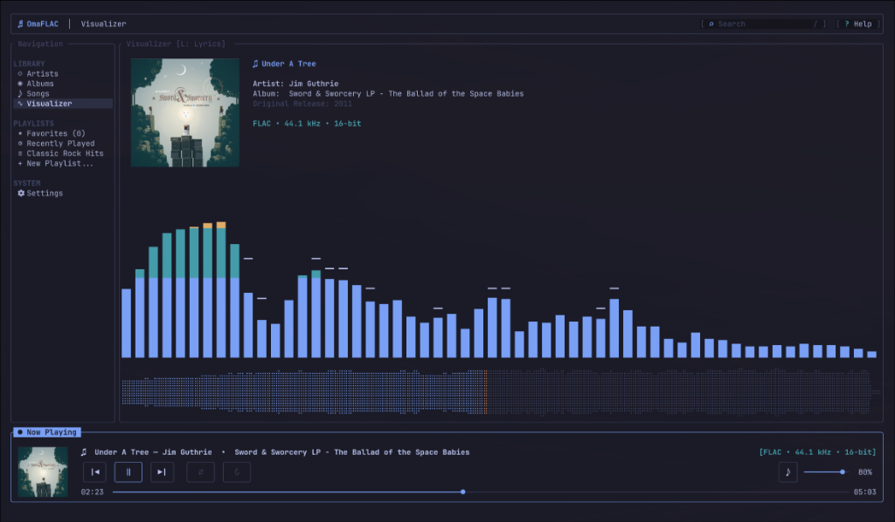
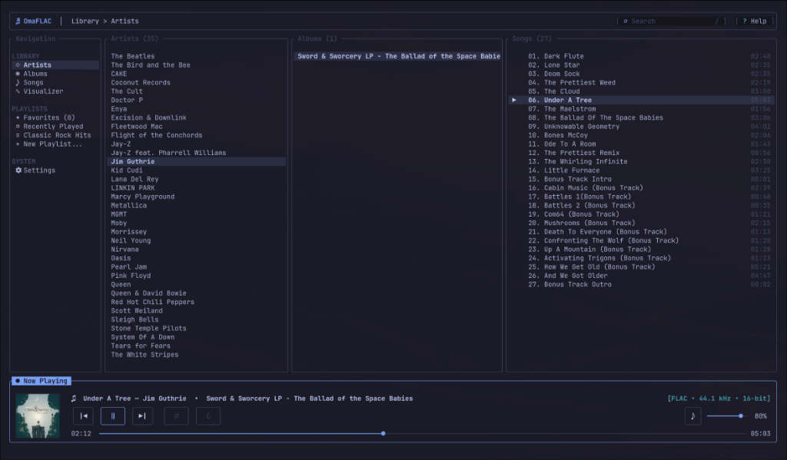
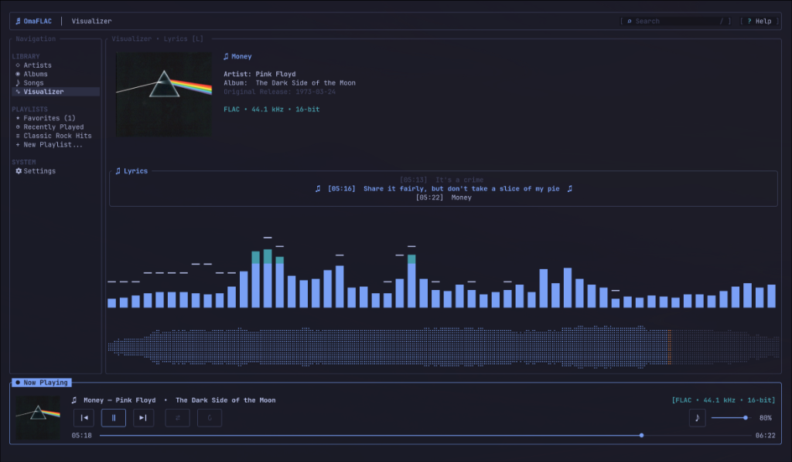
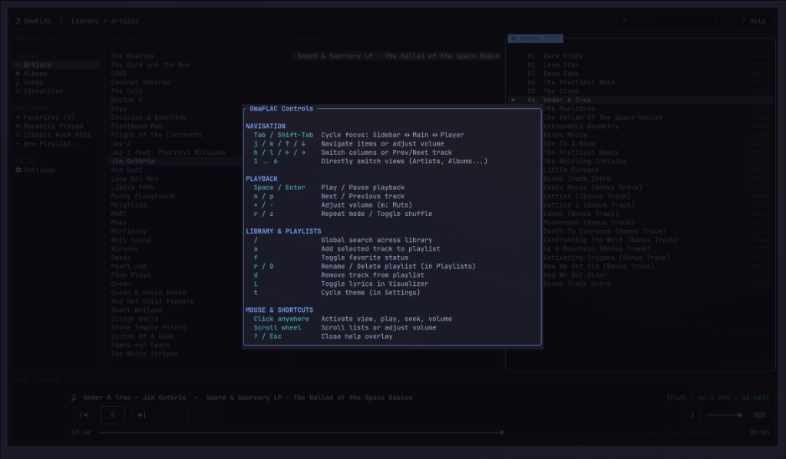
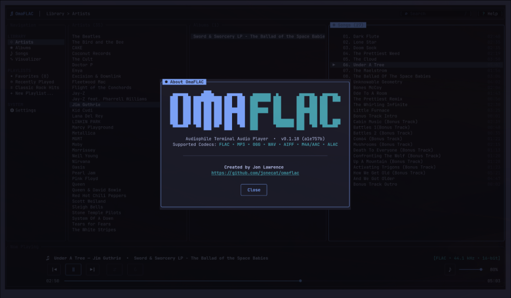

# ♬ OmaFLAC

> **Audiophile Terminal Music Player built for Omarchy Linux — with full support for Linux & macOS**  
> Written in pure Rust with Ratatui, Symphonia, CPAL, Lofty, and RustFFT.

`OmaFLAC` is a high-fidelity Terminal User Interface (TUI) audio player originally engineered for **Omarchy Linux** and designed to run seamlessly across **all modern Linux distributions** as well as **macOS**. Combining the signature Omarchy aesthetic with an audiophile-grade gapless playback engine, `OmaFLAC` delivers 24-bit truecolor album artwork, time-synchronized 3-line lyrics, a real-time FFT frequency spectrum analyzer, `btop`-inspired Braille track waveforms, an interactive directory explorer modal, and 100% parity between keyboard shortcuts and mouse navigation.

<p align="center">
  
</p>

---

## 📸 Screenshots

| **Hierarchical Library Browser (`1`)** | **Synchronized 3-Line Lyrics (`L`)** |
| :---: | :---: |
|  |  |
| *3-column browser (Artists → Albums → Songs) with persistent Now Playing deck and 24-bit album artwork* | *Time-synchronized 3-line lyrics panel (`L`), album cover art, live spectrum analyzer, and waveform* |
| **Real-Time FFT Visualizer & Waveform (`4`)** | **Interactive Controls & Help Overlay (`?` / `F1`)** |
|  |  |
| *1024-point Hann FFT frequency spectrum analyzer, btop-style Braille waveform, and lossless metadata* | *Interactive keyboard shortcuts & mouse navigation reference overlay* |

<p align="center">
  <b>About OmaFLAC & Codec Support</b><br>
  <br>
  <i>Stylized ASCII branding, build version, Git commit hash, and supported lossless audio codecs</i>
</p>

---

## ✨ Features

- **Audiophile Gapless Playback & Sample-Rate Interpolation**:
  - Native decoding for **FLAC**, **MP3**, **OGG** (Vorbis), **WAV**, **AIFF**, **M4A/AAC**, and **ALAC** via `symphonia`.
  - True **gapless transitions** with background track pre-buffering and lock-free boundary handoff.
  - Real-time linear **sample-rate interpolation** so 44.1 kHz, 88.2 kHz, 96 kHz, and 192 kHz lossless tracks play at exact pitch and speed on 48 kHz+ output devices across **Linux** (PipeWire, PulseAudio, ALSA) and **macOS** (CoreAudio).
- **Synchronized 3-Line Lyrics Engine**:
  - **Just-in-Time LRCLIB Integration**: Fetches time-synchronized `.lrc` lyrics on-demand via the free, open-source [LRCLIB](https://lrclib.net) community database—no account, token, or API key needed.
  - **Local Sidecar `.lrc` Support**: Automatically detects and prioritizes local `.lrc` files located alongside audio tracks in your library (`<track>.lrc`).
  - **Offline Disk Caching & Negative Caching**: Saves fetched lyrics locally (`~/.cache/omaflac/lyrics/` on Linux, `~/Library/Caches/omaflac/lyrics/` on macOS) for 0ms offline access, and caches negative markers for instrumentals or missing lyrics to prevent redundant network queries.
  - **Predictive Gapless Pre-Fetching**: Pre-fetches upcoming track lyrics concurrently during gapless audio pre-buffering so line 1 is ready the moment the song transitions.
  - **Focused 3-Line Presentation**: Displays previous line (dimmed), current active line (bold theme accent `♫`), and upcoming line, with dynamic `♪ Instrumental Break ♪` detection during long pauses and solos.
  - **One-Key Toggle**: Press **`L`** anywhere (or click the lyrics panel) to toggle the lyrics display on or off.
- **Full Keyboard & Mouse Parity**:
  - Every control—3-row tactile transport buttons (`|◁`, `▶`/`‖`, `■`, `▷|`, `⇄`, `↻`), waveform seekbar, volume slider, sidebar navigation, and modals—supports both mouse clicks/scrolling and fast Vim-style keyboard navigation (`j`/`k`, `h`/`l`, `Tab`, `Space`, `/`).
  - Click **`♬ OmaFLAC`** in the top bar at any time to open the **About OmaFLAC** modal featuring stylized ASCII art, build version + Git commit hash, and a clickable link to the GitHub repository.
- **24-bit Truecolor Album Artwork**:
  - Extracts embedded artwork tags (ID3v2 APIC, FLAC picture blocks, MP4 `covr`) and detects folder covers (`cover.jpg`, `folder.png`, etc.).
  - Renders crisp album covers using an adaptive half-block (`▀`) 24-bit RGB renderer and protocol-aware terminal image engine (Kitty, Sixel, iTerm2, Ghostty, WezTerm, Alacritty, Foot).
- **Real-Time FFT Spectrum Visualizer**:
  - Live lock-free audio tap feeding a 1024-point Hann-windowed Fast Fourier Transform (`rustfft`).
  - Logarithmically spaced frequency bands with smooth attack/decay ballistics rendered in the **Visualizer** view.
- **High-Resolution Braille Track Waveform**:
  - Pre-calculates full-track amplitude dynamics in a background worker thread and caches waveforms on disk.
  - Renders a `btop`-style 2×4 Braille matrix (`U+2800..U+28FF`) waveform with played vs. unplayed color coding and instant click-to-seek.
- **Hierarchical Library & Playlists**:
  - **Artists (`1`)**: 3-column hierarchical browser (**Artists → Albums → Songs**).
  - **Albums (`2`)**: Two-pane album catalog and tracklist browser.
  - **Songs (`3`)**: Filterable library table with track metadata, duration, format badges, and favorite stars (`★`).
  - **Visualizer (`4`)**: Large album cover art, lossless format/sample-rate/bit-depth readout, synchronized 3-line lyrics panel (`L`), live FFT spectrum analyzer, and compact track waveform. Full skip back and forth via `←`/`→` or `h`/`l`.
  - **Playlists (`5`)**: Built-in **★ Favorites**, **◷ Recently Played**, and custom user playlists (`a` to add tracks, `n` to create playlists, `d` to remove tracks).
  - **Settings (`6`)**: Manage library folders via an interactive **Add Library Folder** modal, trigger incremental library syncs (`s`) or full metadata rescans (`S`), and check/install **Application Updates** directly inside the TUI.
- **Incremental Background Library Sync (Remote / NAS Friendly)**:
  - Loads your cached library instantaneously on startup and automatically runs a non-destructive incremental sync in the background (`⟳ Syncing...` in the top bar).
  - Uses file size + modification timestamp (`stat`) caching to skip opening unchanged files over network mounts, streams additions/removals live without cursor jumping, and preserves cached tracks if a remote server/NAS is offline.
- **Built-In Version Checker & Self-Updater**:
  - Non-blocking background check against GitHub on startup; displays a clickable `[↑ Update v...]` badge in the top bar when a newer release or commit is available.
  - Update in-app from **Settings (`6`)** while music continues playing, or from the terminal via `omaflac update`.
- **Global Instant Search**:
  - Press `/` or click the top search bar to filter across Artists, Albums, and Songs in real time.
- **Terminal-Synchronized Theme Engine**:
  - Automatically assumes and locks to your host terminal emulator's palette (Ghostty, Kitty, Alacritty, WezTerm, Foot, Omarchy, or terminal OSC 10/11 query) with zero-configuration live hot-reloading.

---

## 🚀 Quick Install & Updating (Linux & macOS)

Install `OmaFLAC` with a single command on **Linux** or **macOS**:

```bash
curl -fsSL https://raw.githubusercontent.com/jonecat/omaflac/main/install.sh | bash
```

The installer script automatically:
1. Detects your operating system (**Linux** distro or **macOS**) and architecture.
2. Verifies required build tools (`git`, C compiler, `cargo`/`rustc`, and `pkg-config` + ALSA headers on Linux) and prints exact, copy-pasteable commands for your OS/distro if anything needs to be installed first.
3. Clones and compiles an optimized release binary (`cargo build --release`) and installs it to `~/.local/bin/omaflac`.

### 🔄 Checking for Updates & Self-Updating

`OmaFLAC` embeds both its semantic version and Git commit hash at compile time and supports updating from either the CLI or inside the application:

```bash
# Print installed version and Git commit hash
omaflac --version

# Check GitHub for a newer release or commit
omaflac check-update

# Download, compile, and install the latest version from GitHub
omaflac update

# Force a clean rebuild & reinstall of the latest version
omaflac update --force
```

Inside the TUI, navigate to **Settings (`6`)** (or click the **`[↑ Update]`** badge in the header when available) to check for updates (`u`), download & compile the latest update in the background (`U`), and seamlessly restart into the new binary (`R`).

---

## 🛠️ Manual Installation & Dependencies

### 1. System Prerequisites

#### Omarchy Linux / Arch Linux
```bash
sudo pacman -S --needed base-devel pkgconf alsa-lib git rust
```

#### Debian / Ubuntu / Pop!_OS / Linux Mint
```bash
sudo apt update && sudo apt install -y build-essential pkg-config libasound2-dev git curl
```

#### Fedora / RHEL
```bash
sudo dnf install -y gcc make pkgconf-pkg-config alsa-lib-devel git curl
```

#### openSUSE
```bash
sudo zypper install -y gcc make pkg-config alsa-devel git curl
```

#### macOS (Apple Silicon & Intel)
CoreAudio is included with macOS. Only Xcode Command Line Tools and Rust are required:
```bash
xcode-select --install
```

*(If you don't have the Rust toolchain installed yet on Linux or macOS, install it via [rustup](https://rustup.rs):)*
```bash
curl --proto '=https' --tlsv1.2 -sSf https://sh.rustup.rs | sh
```

### 2. Build from Source

```bash
# Clone the repository
git clone https://github.com/jonecat/omaflac.git
cd omaflac

# Build optimized release binary
cargo build --release

# Install to ~/.local/bin
mkdir -p ~/.local/bin
cp target/release/omaflac ~/.local/bin/omaflac

# Run OmaFLAC
omaflac
```

---

## ⌨️ Controls & Shortcuts

| Action | Shortcut / Mouse |
| :--- | :--- |
| **Play / Pause** | `Space` or click `▶` / `‖` |
| **Next Track** | `n` or click `▷\|` (or `→` / `l` in Visualizer & Player Bar) |
| **Previous Track** | `p` or click `\|◁` (or `←` / `h` in Visualizer & Player Bar) |
| **Toggle Lyrics Display** | `L` or click the Lyrics card (in Visualizer) |
| **Seek Backward / Forward 5s** | `←` / `→` (in Songs list) or click on progress / waveform bar |
| **Seek Backward / Forward 30s** | `[` / `]` or `Shift + ←` / `Shift + →` (in library lists) |
| **Volume Up / Down (5%)** | `+` / `-` or click/scroll on volume bar (`k` / `j` in Player Bar) |
| **Mute / Unmute** | `m` or click `VOL` / `MUTE` |
| **Cycle Repeat Mode (Off / All / 1)** | `r` or click `↻` |
| **Toggle Shuffle** | `z` or click `⇄` |
| **Global Search** | `/` or click the search bar |
| **Add Track to Playlist** | `a` |
| **Toggle Favorite Track** | `f` or click `★` |
| **Cycle Focus Area** | `Tab` / `Shift+Tab` |
| **Direct View Shortcuts** | `1` Artists, `2` Albums, `3` Songs, `4` Visualizer, `5` Playlists, `6` Settings |
| **Navigate Lists** | `j` / `k` or `↑` / `↓` or mouse wheel |
| **Switch Columns / Skip Track** | `h` / `l` or `←` / `→` or click column |
| **Play Selected Item** | `Enter` or double-click row |
| **Remove Track / Playlist** | `d` (track) or `D` (playlist) or `Delete` |
| **Check / Install Updates (Settings)** | `u` Check, `U` Install Update, `R` Restart |
| **About OmaFLAC Modal** | Click `♬ OmaFLAC` in top header bar |
| **Open Help Overlay** | `?` or `F1` or click `[? Help]` |
| **Quit** | `q` or `Ctrl+C` |

---

## 📁 Configuration & Data Paths

`OmaFLAC` stores user configuration and cached library metadata in standard system config and cache directories:
- `~/.config/omaflac/config.json`: Library folders, volume, repeat mode, shuffle state, and lyrics visibility (`show_lyrics`).
- `~/.config/omaflac/library.json`: Scanned track database and metadata index.
- `~/.config/omaflac/playlists.json`: User-created playlists, favorites, and recently played tracks.
- `~/.config/omaflac/waveforms/`: Cached track amplitude waveforms for instant loading.
- `~/.cache/omaflac/lyrics/` (*macOS:* `~/Library/Caches/omaflac/lyrics/`): Cached synchronized `.lrc` lyrics for instant offline playback.

---

## 🏗️ Architecture

```text
omaflac/
├── assets/                             # Screenshot assets for GitHub documentation
│   └── screenshots/
├── build.rs                            # Embeds compile-time Git commit hash (OMAFLAC_GIT_HASH)
├── install.sh                          # Cross-platform installer & updater script (Linux & macOS)
└── src/
    ├── main.rs                         # CLI flags (--version, check-update, update), TUI setup & loop
    ├── lib.rs                          # Library crate root
    ├── app.rs                          # Core App state machine, focus routing, keyboard & mouse handlers
    ├── config.rs                       # Persistent configuration (~/.config/omaflac/config.json)
    ├── updater.rs                      # Background GitHub version checker & self-updater engine
    ├── audio/
    │   ├── mod.rs                      # AudioEngine public facade
    │   ├── player.rs                   # CPAL output stream, Symphonia decoder, gapless queue & resampler
    │   ├── visualizer.rs               # Lock-free 1024-point FFT audio bridge & smoothing physics
    │   └── waveform.rs                 # Background track dynamics analyzer & waveform cache
    ├── lyrics/
    │   ├── mod.rs                      # LyricsManager facade, background worker threads & channel polling
    │   ├── lrc.rs                      # Synchronized .lrc timestamp parser & sliding window logic
    │   └── client.rs                   # LRCLIB API client, disk cache & negative caching
    ├── library/
    │   ├── mod.rs                      # In-memory library catalog, search index, Artist/Album hierarchy
    │   ├── track.rs                    # Track metadata model & lossless format descriptors
    │   ├── scanner.rs                  # Multithreaded recursive directory scanner (walkdir + lofty)
    │   └── playlist.rs                 # PlaylistsManager for Favorites, Recently Played & custom playlists
    └── ui/
        ├── mod.rs                      # Root layout, bordered header, view dispatcher & modal overlays
        ├── theme.rs                    # Omarchy color palette, rounded block helpers & typography
        ├── artwork.rs                  # 24-bit RGB half-block & terminal protocol album cover renderer
        ├── spectrum.rs                 # Real-time FFT frequency spectrum analyzer widget
        ├── waveform_widget.rs          # 2x4 Braille matrix track waveform widget
        ├── mouse.rs                    # Mouse hit-testing utilities
        ├── components/
        │   ├── header.rs               # Top bar: clickable OmaFLAC logo, global search, update & status badges
        │   ├── sidebar.rs              # Navigation panel: Artists, Albums, Songs, Visualizer, Playlists
        │   ├── player_bar.rs           # Bottom deck: 3-row transport buttons, seekbar & volume
        │   ├── about_modal.rs          # Stylized ASCII art "About OmaFLAC" modal dialog
        │   ├── folder_dialog.rs        # Interactive "Add Library Folder" path input & directory browser modal
        │   ├── playlist_dialog.rs      # Add-to-playlist / New-playlist modal dialog
        │   └── help_modal.rs           # Keyboard & mouse controls reference overlay
        └── views/
            ├── artists_view.rs         # 3-column hierarchical browser (Artists → Albums → Songs)
            ├── albums_view.rs          # 2-column Album catalog & Songs browser
            ├── songs_view.rs           # Filterable track table with favorite stars
            ├── search_results_view.rs  # 3-column instant search results (Artists, Albums, Songs)
            ├── now_playing.rs          # Visualizer view: cover art, metadata, lyrics card, FFT spectrum & waveform
            ├── playlists_view.rs       # Playlist manager and track listing
            ├── settings_view.rs        # Library folder management, rescan & application updates
            └── file_browser.rs         # Standalone filesystem browser view
```

---

## 👤 Author & License

Created by **Jon Lawrence** — [https://github.com/jonecat/omaflac](https://github.com/jonecat/omaflac)

Released under the **MIT License**. Built for **Omarchy Linux**, Linux, and macOS.
